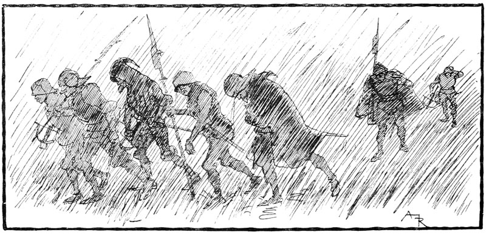

Respectable folk spit the word. *Burners* — the drifters who blow into a harbor town on the evening tide with a sword, a spell, or a set of picks, take the job nobody sane will touch, and are gone by the next fog. You are not here to save the Dragon Isles; you are here to get in, get paid, and get out with your skin — and if the place is on fire behind you as you go, well… it usually is.

## The Books

- **Adventure Game** — the core rules.
- **FAQ** — questions that come up at the table.
- **Experience** — XP awards, claimed treasure, who tracks what.
- **Equipment** — gear and goods.
- **Sorcerie** — how magic works.
- **Spells** — the eight schools and every working.
- **Invocations** — bargains with the otherworldly.
- **Muster** — retainers, Muster slots, and Loyalty.
- **Ancestry** — the peoples of the Dragon Isles.
- **Arms & Armor** — weapons and the armor ladder.
- **Examples of Play** — a full job at the table, roll by roll.
- **Burn Undead** — the Fallen, fire, Turn / Brandish, Fallen Wounds, Midnight, purge.
- **Referee Guide** — running the game.
- **Referee Magic Items** — enchanted arms, +n loot, conversion.
- **OSE Conversions** — playing with Old-School Essentials material.
- **Principles** — design spine: granular defense, route don't reinvent, no keys, no plusses.

paulabrams.github.io/burners
